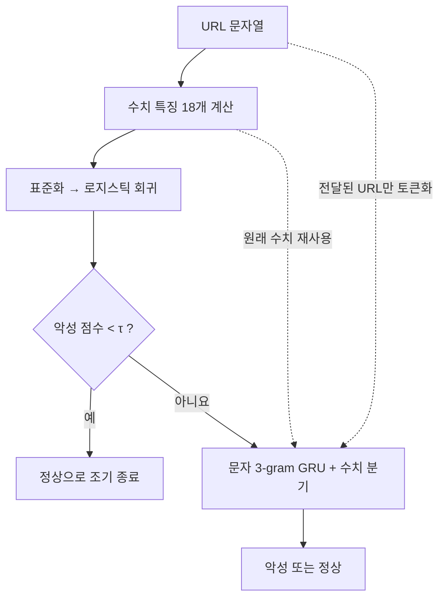

# Malicious URL Cascade

**모든 URL에 GRU를 실행해야 할까요?** 이 프로젝트는 가벼운 로지스틱 회귀가 정상일 가능성이 높은 URL을 먼저 걸러낼 때, 악성 URL을 얼마나 더 놓치고 실제 처리시간을 얼마나 줄이는지 측정합니다. 한국외국어대학교 컴퓨터보안 수업의 3인 팀프로젝트입니다.

Munna Ram의 문자 3-gram GRU를 재현하는 **실험 A**와, 도메인을 분리한 데이터에서 같은 GRU에 게이트를 추가하는 **실험 B**를 독립적으로 진행합니다. 팀이 구현한 부분은 도메인 중복 감사·분할, 경량 분류기, 선택적 GRU 호출, 추가 미탐 검증과 처리시간 측정입니다. [원본 모델](https://github.com/munna0912/URL_CLASSIFIER/tree/835bd5e1710531407c0b5ca09da3d7c3de8d1bbc) · [재현 방법](docs/reproduction.md)

## URL 한 건이 처리되는 과정



T1의 악성 점수가 임계값과 같으면 T2가 판정합니다. T2는 원본 모델처럼 **정상 점수**를 출력하며 정확히 0.5이면 정상입니다. 같은 T2를 사용하므로 캐스케이드가 추가로 놓치는 악성 URL은 ‘T2 단독으로 탐지됐지만 조기 종료된 건’으로 직접 셀 수 있습니다. 데이터에 포함된 URL은 문자열로만 처리합니다. [추론 구현](urlcascade/core.py) · [경계값 테스트](tests/test_core.py)

## 지금까지 확인한 결과

| 질문 | 실측 결과 | 근거 |
| --- | --- | --- |
| 원본 모델의 내부 검증 결과가 재현됐나요? | 20 epoch의 정확도는 원본 기록 **98.34%**, 팀 실행 **98.40%**입니다. 팀 모델은 악성 70,394건 중 68,895건을 탐지했습니다(**97.87%**). | [실험 A 결과·혼동행렬·해시](evidence/experiment-a-internal.json) |
| 실험 B에서는 어떤 모델을 선택했나요? | 모델 선택용 75,946건에서 T1은 **C=10**일 때 악성 평균 정밀도(AP)가 **0.978709**로 가장 높았습니다. T2는 20개 epoch 중 **5번째**에서 이진 교차 엔트로피(BCE)가 **0.118248**로 가장 낮았습니다. | [후보별 AP·epoch별 BCE·동결 모델 해시](evidence/experiment-b-selection.json) |
| 같은 도메인이 학습·평가 양쪽에 들어갔나요? | 내부 779,923건을 네 집합으로 동결했습니다. 등록 도메인 교집합은 여섯 쌍 모두 0건입니다. | [분할별 건수와 SHA-256](evidence/b-split-manifest.json) · [중복 감사](evidence/hufs-w1-w3-result.json) |
| 어떤 장비에서 이 GRU를 학습했나요? | 같은 학습 표본 50,000건, 배치 128에서 두 번째 epoch는 CPU **17.35초**, Tesla T4 **74.15초**였습니다. 이 측정에 따라 본학습 장비로 CPU를 선택했습니다. | [장비·표본·epoch별 시간](evidence/hufs-w1-w3-result.json) |
| 저장한 모델을 새 세션에서 복원할 수 있나요? | smoke 모델을 복원한 뒤 확인용 입력 3건에서 정상 점수의 최대 절대 차이가 **0**이었고 판정도 모두 일치했습니다. | [복원 기록](evidence/w4-run-observation.json) |

실험 B의 모델과 어휘를 동결하고 Kaggle CPU에서 별도 게이트 선택 실행을 시작했습니다. 게이트 선택용 86,371건에서 추가 미탐과 처리시간을 확인한 뒤 임계값을 동결합니다. 최종 시험의 악성 Recall과 캐스케이드 추론 속도 향상률은 평가 대기 중입니다. [재현 가이드](docs/reproduction.md#동결-후-시험과-외부-평가)

## 비교 설계

| | 실험 A · 원본 재현 | 실험 B · 캐스케이드 평가 |
| --- | --- | --- |
| 데이터 | 원본 전처리와 층화 80/20 분할, seed 42 | 등록 도메인 기준 학습 470,281건 / 모델 선택 75,946건 / 게이트 선택 86,371건 / 최종 시험 147,325건 |
| 학습·선택 | 문자 3-gram, 어휘 10,000, 길이 50, Embedding 16, GRU 16. 배치 128, 20 epoch | 학습 집합에서 스케일러와 어휘를 fit. 모델 선택 집합에서 악성 AP로 T1의 C를, BCE로 T2의 epoch를 선택 |
| 평가 | A에서 학습한 가중치와 어휘로 내부 재현 결과 산출 | 항상 정상 / T1 단독 / T2 단독 / 캐스케이드. 게이트 선택 집합에서 T2 대비 악성 Recall 감소가 **1%p 이내**인 후보의 전체 처리시간을 측정 |

최종 시험은 모델과 게이트를 동결한 뒤 실행합니다. 내부와 겹치는 도메인을 제거한 외부 평가 집합은 **58,858건 모두 악성**이어서 악성 탐지율을 평가할 수 있고, 정상 URL의 오탐률은 계산할 수 없습니다. [감사 결과](evidence/hufs-w1-w3-result.json) · [벤치마크 구현](urlcascade/benchmark.py)

## 직접 확인하기

Python 3.10에서 아래 명령으로 데이터나 모델 다운로드 없이 라우팅·점수 경계·분할 검사를 실행할 수 있습니다.

```bash
python3.10 -m unittest discover -s tests -v
```

전체 데이터로 재현할 때는 원저자의 고정 커밋에서 필요한 모듈을 받아 해시를 검사합니다. 데이터 출처, 노트북 실행 순서, 원래 실행본의 식별자는 [재현 가이드](docs/reproduction.md)에 있습니다.
