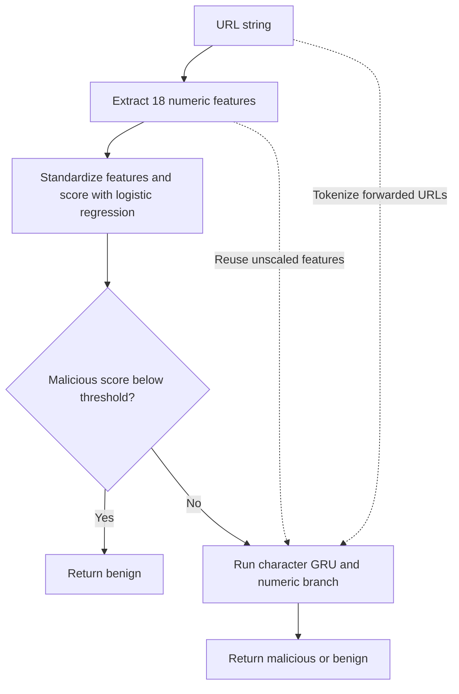

# Malicious URL Cascade

Can a lightweight classifier skip recurrent inference on likely benign URLs while keeping the loss in malicious recall within one percentage point? This three-person Computer Security project at Hankuk University of Foreign Studies measures both the extra malicious URLs missed and the time saved per request.

Experiment A reproduces Munna Ram's character 3-gram GRU. Experiment B trains a separate GRU on domain-separated data and places a logistic regression gate in front of it. The project adds a domain-overlap audit, selective GRU execution and an end-to-end timing benchmark. [Upstream model](https://github.com/munna0912/URL_CLASSIFIER/tree/835bd5e1710531407c0b5ca09da3d7c3de8d1bbc) · [Technical report draft](docs/report.md) · [Reproduction guide](docs/reproduction.md)

## How the cascade classifies one URL



A T1 score equal to the threshold forwards the URL to T2. T2 outputs a benign score and classifies an exact score of 0.5 as benign. An additional false negative is a malicious URL caught by T2 alone and missed because the cascade exited early. All dataset URLs are processed as strings offline. [Inference code](urlcascade/core.py) · [Boundary tests](tests/test_core.py)

## Verified results

| Question | Observation | Evidence |
| --- | --- | --- |
| How closely did A reproduce internal validation accuracy? | At epoch 20 the upstream notebook recorded **98.34%** and the team obtained **98.40%**. The team model detected **68,895 of 70,394** malicious URLs (**97.87% recall**). | [A results and confusion matrix](evidence/experiment-a-internal.json) |
| Which models were frozen for B? | On 75,946 model-selection rows, T1 achieved its highest malicious average precision (**0.978709**) at **C = 10**. T2 attained its lowest validation binary cross-entropy (**0.118248**) at **epoch 5** of 20. | [Candidate scores, epoch history and hashes](evidence/experiment-b-selection.json) |
| Did the internal partitions share domains? | The four partitions contain 779,923 URLs. All six pairwise intersections of domain groups were empty. | [Split manifest](evidence/b-split-manifest.json) · [Overlap audit](evidence/hufs-w1-w3-result.json) |
| Why train on CPU? | On the same 50,000-row pilot at batch size 128, the second epoch took **17.35 s on CPU** and **74.15 s on a Tesla T4**. These are training times. | [Pilot measurements](evidence/hufs-w1-w3-result.json) |
| Did the smoke checkpoint survive restoration? | Three verification inputs produced identical decisions and a maximum absolute benign-score difference of zero after restoration. | [Restoration record](evidence/w4-run-observation.json) |

The gate-selection run froze **τ = 0.10**. On 86,371 gate-selection URLs, the cascade missed **291 additional malicious URLs out of 37,440** (0.7772 percentage points of recall) and called the GRU **61.48%** of the time. Median-of-mean single-request latency fell from **389.92 ms to 241.47 ms**. Independent archive verification reproduced the threshold from eight candidates and five timing runs per eligible candidate. Held-out evaluation is pending. [Gate-selection evidence](evidence/experiment-b-gate.json) · [Evaluation procedure](docs/reproduction.md#frozen-policy-evaluation)

## Experimental design

| | A · Upstream reproduction | B · Cascade evaluation |
| --- | --- | --- |
| Data | Upstream preprocessing and a stratified 80/20 split with seed 42 | Domain-disjoint training (470,281), model selection (75,946), gate selection (86,371) and internal test (147,325) |
| Model selection | Character 3-grams, vocabulary capacity 10,000, sequence length 50, embedding size 16, GRU size 16, batch size 128 and 20 epochs | Fit the scaler and vocabulary on training data. Select T1 by malicious average precision and T2 by validation binary cross-entropy. |
| Evaluation | Score the internal validation set using A's weights and vocabulary | Compare always-benign, T1 alone, T2 alone and the cascade. Time eligible gates whose malicious recall loss is at most one percentage point relative to T2. |

The independent external cohort contains **58,858 malicious URLs** after overlap exclusion. It supports an estimate of malicious recall. Its benign denominator is zero, so the false-positive rate is undefined. [Data audit](evidence/hufs-w1-w3-result.json) · [Timing harness](urlcascade/benchmark.py)

## Run the local checks

From the repository root, run the routing, score-boundary and partition checks with Python 3.10. The basic suite runs offline. The upstream parity and NumPy-dependent tests run when their dependencies are available.

```bash
python3.10 -m unittest discover -s tests -v
```

The reproduction guide covers source verification, notebook order, frozen archive validation and offline prediction. [Reproduction guide](docs/reproduction.md)
