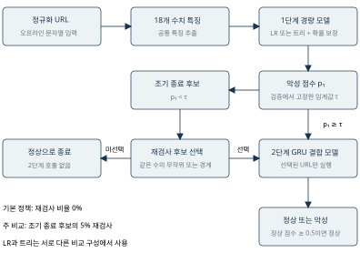
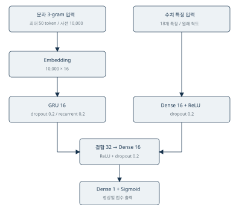
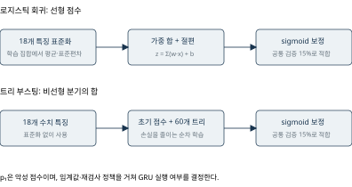
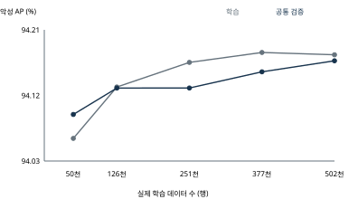
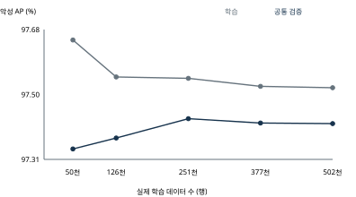
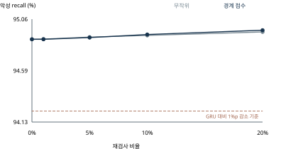
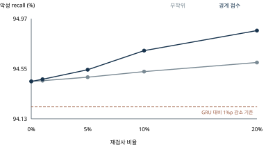
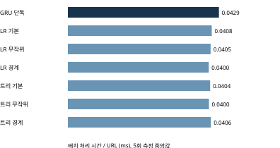

# 정제 데이터 기반 악성 URL 탐지와 선택적 GRU 캐스케이드의 성능 및 비용 분석

배진규 202001647 · 이성준 202102467 · 장태현 202102966
한국외국어대학교 컴퓨터보안 팀프로젝트

재실험 기준일 2026년 11월 16일 | 실행 증거 기반 기술 보고서

## 초록

최종 설계는 학습 70% / 검증 15% / 시험 15%이며, 검증 전체를 모델 선택·확률 보정·분기 기준 선택에 공통으로 사용한다. 이전 5/5/5 검증 설계의 시험 결과를 확인한 뒤 검증 전체를 활용하는 설계로 변경했으므로, 같은 시험 집합의 재평가 이력을 함께 보고한다.

본 프로젝트는 공개 URL_CLASSIFIER의 문자 3-gram GRU와 수치 특징 결합 모델을 재현하고, 경량 분류기로 일부 정상 URL을 먼저 처리하는 2단계 캐스케이드를 평가한다. 1단계에는 로지스틱 회귀와 히스토그램 기반 트리 부스팅을 각각 사용하고, 기본 정책과 동일 비율의 무작위·경계 점수 재검사를 비교한다.

원자료에서 중복과 상충하는 라벨이 확인되어 기존 결과를 참고 비교로 분리했다. 원저자에게 2026년 11월 11일 정제 데이터 제공을 요청했으나 11월 16일 메일 확인 시 회신이 없어, 교수님의 안내에 따라 세 파일을 통합·정제했다. 최종 717,793개 URL을 학습·검증·시험 약 70/15/15로 나누고 모델과 분기 설정을 새로 학습하도록 설계했다. 문자 사전 적용 이후의 입력 중복도 별도로 제거했다.

주 시험 데이터에서 GRU 단독의 악성 재현율은 95.229%, LR 경계 재검사는 94.893%, 트리 경계 재검사는 94.540%였다. 결과는 정제·통합 후 새로 분할한 데이터에서의 평가이며, 원저자 수치와 동일 조건의 우열 비교를 뜻하지 않는다. 도메인 분리 결과와 실제 선택적 추론 시간을 함께 제시한다.

트리 경계 재검사는 GRU 호출을 26.046% 줄이는 대신 악성 recall이 0.689%p 감소했다. 같은 1,000개 배치의 전체 처리 시간 중앙값은 5.33% 감소했다. 호출 감소와 시간 절감은 별개 지표로 해석했다.

## 1 연구 문제와 기여

악성 URL 탐지는 사용자가 피싱·악성코드 배포 주소에 접근하기 전에 위험을 판별하는 보안 문제다. 본 실험은 URL 문자열만 사용하며 실제 사이트 방문, DNS 조회, 콘텐츠 다운로드를 수행하지 않는다. 공개 데이터의 문자열에서 어휘·구조 정보를 이용하지만, URL이 가리키는 사이트의 현재 상태까지 검증하는 시스템은 아니다.

GRU는 문자 순서에서 패턴을 학습하지만 모든 URL에 반복 신경망을 실행하면 처리 비용이 발생한다. 반면 길이와 특수문자 수 등 18개 수치 특징만 사용하는 분류기는 상대적으로 단순하다. 충분히 정상으로 판단되는 입력을 경량 모델에서 종료하고 나머지만 GRU로 보내면 비용을 줄일 수 있으나, 조기 종료된 악성 URL은 2단계에서 복구할 기회를 잃는다.

따라서 핵심 질문은 정확도 수치 하나를 높이는 것이 아니라, GRU 대비 악성 재현율 감소를 1%p 이내로 제한하면서 2단계 호출과 실제 처리 시간을 얼마나 줄일 수 있는가이다. 재검사는 이 추가 미탐을 일부 복구하는 장치이며, 복구량·추가 오탐·계산 비용을 함께 평가해야 한다.

| 연구 질문 | 대응 실험 |
| --- | --- |
| 경량 모델의 선택이 어떤 차이를 만드는가 | 같은 분할·18개 특징·공통 GRU에서 LR과 트리 비교 |
| 경계 재검사가 무작위보다 효과적인가 | 동일 개수 재검사, 악성 복구와 정상 오탐 비교 |
| 임계값과 재검사 비율에 얼마나 민감한가 | 고정 후보 격자의 탐지율·2단계 호출률 곡선 |
| 도메인 중복에 성능이 의존하는가 | 도메인이 겹치지 않는 별도 재학습과 평가 |

원저자에게서 재사용한 부분은 수치 특징 추출, 문자 전처리와 GRU 결합 구조다. 팀의 확장은 1단계 선택적 추론, 두 경량 모델의 비교, 동일 예산 재검사, 데이터 충돌과 입력 중복의 감사, 분할별 성능·시간 측정이다. 두 경량 모델을 동시에 결합한 앙상블이 아니라 서로 다른 1단계 대안을 비교한다.

## 2 원저자 모델과 기존 재현 결과

참조 저장소는 munna0912/URL_CLASSIFIER이며 고정 소스의 노트북과 모델 파일을 확인했다[1]. 실제 구현은 문자 분기와 수치 분기의 벡터를 연결한 하나의 신경망이다. 두 독립 모델의 점수를 평균 내는 구조로 설명하지 않는다. 원래 라벨은 0=악성, 1=정상이고, 최종 sigmoid도 정상 점수를 출력한다.

원저자 노트북의 첫 학습 블록은 df_final.csv와 all_top_domains_merged.csv를 합쳐 내부 학습·검증에 사용한다. 뒤쪽의 전체 데이터 재학습 블록에는 df_another_validation.csv까지 들어간다. 따라서 뒤쪽 모델에 이 파일을 다시 적용한 값을 독립 시험 성능으로 해석할 수 없다. 본 비교는 첫 학습 블록의 20번째 epoch 내부 검증 기록으로 한정했다.

표 1 기존 문제 데이터에서의 간단한 재현 비교

| 기존 데이터 평가 | 내부 검증 정확도 | 조건과 근거 |
| --- | --- | --- |
| 원저자 공개 기록 | 98.340% | 첫 model.fit의 epoch 20 출력 |
| 팀의 기존 재현 기록 | 98.400% | 80/20, seed 42, epoch 20; 156,334개 |
| 차이 | +0.060%p | 반올림 수치의 차이; 우월성 주장 불가 |

팀의 기존 혼동행렬은 정상 84,937개 정분류·1,003개 오탐, 악성 68,895개 탐지·1,499개 미탐이었다. 이는 기존 저장 실험 증거를 이번에 읽어 확인한 역사적 결과이며, 이번 세션에서 해당 80/20 실험을 다시 실행한 결과는 아니다. 약 0.06%p의 정확도 차이는 코드 실행과 결과 수준의 유사성을 보여 주는 참고 정보다[2].

이후 세 원파일 전체에서 양쪽 라벨을 가진 원본 URL 문자열 96,007개가 발견됐다. 기존 시험 파일은 충돌 제거 후에도 정상 344,796행이 내부 학습·검증 원천과 정확히 겹쳤다. 이 중복을 모두 제외하면 악성 66,392개와 제어문자를 포함한 정상 2개만 남는다는 사전 감사가 원저자 문의의 근거였다. 이런 시험 집합으로 정상 오탐률을 대표성 있게 평가하기 어렵기 때문에 새 정제 데이터 실험으로 전환했다[3].

새 실험과 원저자 결과는 모집단, 정제 규칙, 분할, 모델 선택 조건이 다르다. 새 결과가 더 높거나 낮더라도 그 차이만으로 캐스케이드의 개선이나 정제의 인과효과를 주장하지 않는다. 캐스케이드의 효과는 새 시험 집합 안에서 동일한 GRU와 비교한다.

## 3 데이터 정제와 분할

### 3.1 문제별 처리 도구와 규칙

세 원파일의 SHA-256을 기존 고정 소스의 값과 대조한 뒤 원본을 수정하지 않고 별도 디렉터리에 결과를 저장했다. pandas로 CSV를 문자열 그대로 읽고 빈 문자열을 임의의 결측치로 바꾸지 않았다. 라벨이 0 또는 1이 아닌 경우에는 실행을 중단하며, 평가용 라벨 y_mal은 1=악성, 0=정상으로 명시적으로 변환했다.

표 2 정제 문제와 해결 방법

| 문제 | 도구와 처리 | 검증 방식 |
| --- | --- | --- |
| 제어문자·잘못된 URL | unicodedata와 urllib.parse로 제어·서식 문자, 비지원 scheme, 호스트·포트 오류 제외 | 제외 사유별 개수와 원행 id 보존 |
| 표기 차이와 URL 중복 | 호스트 소문자화, 경로 끝 slash 제거; 경로·query의 대소문자는 유지 | 정규화 key 유일성 및 재적용 안정성 |
| 원본·정규화 라벨 충돌 | pandas groupby 후 두 라벨이 있는 key의 모든 행 제외 | 다수결 재라벨링 없이 충돌 0 확인 |
| 같은 모델 표현 | 문자 전처리와 18개 특징을 함께 비교; 같은 표현은 하나만 유지 | 상충 라벨 그룹은 모두 제외 |
| 사전·절단 뒤 입력 충돌 | TensorFlow 실제 50 token과 float32 특징의 SHA-256 비교 | 주·도메인 사전 모두 완전 동일 입력 0 |
| 분할 간 정보 누출 | 분할 id 저장, 학습에서만 scaler·사전 적합 | URL·입력 교집합 0, 도메인 실험의 domain 교집합 0 |

표 2-1 통합 전 원파일별 사용 개수; 원자료 type=1은 정상, type=0은 악성

| 원파일 | 전체 | 정상 | 악성 |
| --- | --- | --- | --- |
| df_final.csv | 781,332 | 428,077 | 353,255 |
| all_top_domains_merged.csv | 2,961 | 2,961 | 0 |
| df_another_validation.csv | 507,195 | 392,896 | 114,299 |

정규화는 의미가 달라질 수 있는 경로의 대소문자, query 값, 명시적 포트를 임의로 바꾸지 않는다. HTTP와 HTTPS 또는 scheme이 없는 표기는 무조건 같은 URL로 합치지 않는다. 제어문자는 문자열에서 조용히 지우는 대신 해당 행을 제외해 원래 의도를 추정하지 않았다. 정규화 재적용 시 다시 변하는 불안정한 주소 1개도 마지막 검증에서 격리했다.

표 3 정제 단계별 잔여 데이터 수

| 단계 | 전체 | 정상 | 악성 |
| --- | --- | --- | --- |
| 원자료 합계 | 1,291,488 | 823,934 | 467,554 |
| 제어문자·파싱 오류 제외 후 | 1,290,846 | 823,841 | 467,005 |
| 원본·정규화 충돌 제외 후 | 1,098,995 | 727,921 | 371,074 |
| 정규화 URL 중복 제외 후 | 747,988 | 382,938 | 365,050 |
| 모델 표현 라벨 충돌 제외 후 | 747,986 | 382,937 | 365,049 |
| 모델 표현 중복 제외 후 | 722,749 | 378,469 | 344,280 |
| 실제 token 입력 중복 정제 후 | 717,794 | 376,309 | 341,485 |
| 불안정 정규화 격리 후 최종 | 717,793 | 376,309 | 341,484 |

초기 제외 사유는 제어·서식 문자 200행, 비지원 scheme 13행, 호스트 오류 427행, 파싱 오류 2행이었다. 원본·정규화 라벨 충돌로 191,851행을, 같은 정규화 URL의 중복으로 351,007행을 제외했다. 원본 문자열의 충돌 URL 개수와 제외 행 수는 서로 다른 단위다.

### 3.2 실제 모델 입력까지 확인한 이유

서로 다른 URL도 문자 전처리, 길이 50의 절단, 사전에 없는 문자의 공통 토큰 변환을 거치면 동일한 신경망 입력이 될 수 있다. 문자열 중복만 없애고 분할하면 이 입력이 학습과 시험에 동시에 들어갈 수 있다. 따라서 첫 52개 전처리 문자와 수치 특징을 검사한 뒤, 학습 분할에서 적합한 실제 문자 사전을 적용해 전체 token 배열과 수치 배열의 완전 동일성까지 확인했다.

주 실험 사전과 도메인 실험 사전에서 같은 입력이 되는 그룹을 합쳐, 라벨이 충돌하는 그룹은 모두 제외하고 같은 라벨 그룹은 안정적인 URL id 순서의 한 행만 남겼다. 분할과 학습 사전을 다시 만들며 총 12회 감사했고, 이 단계에서 충돌 19행과 중복 4,936행을 추가 제외했다. 최종 불안정 주소 격리 뒤에도 두 사전을 남은 학습 행만으로 다시 적합하고 동일 입력이 없음을 재검사했다.

이 절차는 동일 입력을 별개의 독립 관측으로 세는 문제를 줄이지만, 원자료의 대표성을 바꾸는 보수적인 선택이다. 거의 같은 주소, 같은 공격 캠페인, 모든 실제 오라벨까지 찾아냈다는 뜻은 아니다. 남은 라벨의 외부 정답 검증은 수행하지 않았으며, 원저자 무응답으로 수집 시점·라벨링 기준의 불확실성이 남는다. 따라서 본 보고서의 “정제”는 명시한 검사 범위의 충돌·중복 해결을 뜻한다.

### 3.3 학습 검증 시험의 역할

표 4 주 실험의 최종 분할

| 주 분할 | 전체 | 정상 | 악성 |
| --- | --- | --- | --- |
| 학습 약 70% | 502,454 | 263,416 | 239,038 |
| 공통 검증 약 15% | 107,669 | 56,446 | 51,223 |
| 시험 약 15% | 107,670 | 56,447 | 51,223 |

학습 70%는 기본 모델의 적합에만 사용하고, 검증 15% 전체를 모델 선택·확률 보정·분기 기준 선택에 공통으로 사용했다. 주 실험의 검증은 107,669행(정상 56,446 / 악성 51,223)이다. 세 과정에 각각 별도의 15%를 추가한 것이 아니라 같은 행을 반복 사용한 설계다.

이전 실행에서는 검증 15%를 모델 선택 35,889행, 보정 35,890행, 정책 선택 35,890행으로 나누었다. 각 5% 분리는 필수 규칙이 아니며, 본 팀은 각 단계에서 더 많은 검증 표본을 활용하도록 설계를 변경했다. 학습·시험 배정과 후보 격자는 유지하고, 세 검증 index의 합집합을 사용해 LR·트리와 GRU를 다시 학습·선택했다.

같은 검증 집합을 반복 사용하면 각 단계의 검증 성능이 해당 자료에 맞춰질 수 있다. 특히 보정 후 Brier score를 같은 보정 자료에서 계산하므로 독립적인 보정 성능 검증으로 해석하지 않는다. 기저 분류기의 학습 70%와 보정에 쓰인 검증 15%는 서로 겹치지 않는다[9].

새 실행에서는 모델 설정·보정 함수·임계값을 모두 고정한 뒤 시험을 평가했고, 그 시험 결과로 다시 조정하지 않았다. 다만 이전 5/5/5 실행의 동일 시험 결과는 이미 확인했다. 따라서 이번 결과는 시험 집합을 처음 보는 맹검 평가가 아니라, 사용자가 요청한 설계 변경 후 같은 시험 집합에서 수행한 추가 평가다. 이전 결과를 설정 선택의 기준으로 쓰지 않았다는 사실과 과거 시험 노출 이력은 구별한다.

층화 무작위 분할의 기준 시드는 42이며 단계별로 43·44·45를 사용했다. 최종 불안정 주소 1개를 격리할 때 배정을 보존해 목표 비율과 정수 반올림 수준의 차이가 있다. 이번 변경에서는 70% 학습과 15% 시험을 다시 섞지 않았다. 사전과 표준화도 동일한 학습 행에서 적합한 범위만 사용한다.

도메인 강건성 실험은 tldextract의 오프라인 Public Suffix List와 private suffix로 등록 가능 도메인을 묶었다. 알려진 접미사가 없으면 전체 호스트를 그룹으로 사용했다. GroupShuffleSplit의 목표 70/15/15는 그룹 비율이므로 실제 행 비율은 다르다. 도메인 실험에서도 검증 121,402행 전체를 세 과정에 공통으로 사용한다.

표 4-1 도메인 그룹 분리의 실제 사용 개수

| 도메인 분할 | 전체 | 정상 | 악성 |
| --- | --- | --- | --- |
| 학습 | 494,984 | 254,767 | 240,217 |
| 공통 검증 | 121,402 | 69,973 | 51,429 |
| 시험 | 101,407 | 51,569 | 49,838 |

표 4-2 과정별 데이터 사용: 검증 세 과정은 같은 행을 재사용

| 과정 | 사용 방법 | 주 실험 (행) | 도메인 (행) |
| --- | --- | --- | --- |
| 사전·표준화 적합 | 학습 행만 사용. StandardScaler는 LR에만 적용 | 502,454 | 494,984 |
| LR·트리 후보 학습 | 각 3개 후보를 같은 학습 행으로 적합 | 502,454 | 494,984 |
| GRU 학습 | 같은 학습 행으로 20 epoch; 매회 공통 검증 | 502,454 | 494,984 |
| 모델 선택 | LR·트리는 AP, GRU는 검증 손실로 선택 | 107,669 | 121,402 |
| 확률 보정 | 선택한 기저 분류기 고정 후 sigmoid 보정 | 107,669 | 121,402 |
| 분기 기준 선택 | 같은 검증에서 12개 τ 중 조건에 맞는 값 동결 | 107,669 | 121,402 |
| 최종 성능 평가 | 동결 모델로 7개 구성 평가. 재학습 없음 | 107,670 | 101,407 |
| 민감도·재검사 진단 | 같은 시험의 사전 격자와 무작위 30 seed | 107,670 | 101,407 |
| 처리 시간 | 시험 고정 표본; warm-up 1회 + 구성별 측정 5회 | 1,000 | 1,000 |

표의 개수는 각 단계의 고유 행 수다. 후보 3개, epoch 20회 또는 검증 3개 역할에 같은 행을 반복 사용했다고 독립 표본 수를 곱하지 않았다. URL 길이 기준선도 해당 학습 전체로 적합한 후 시험 전체에서 평가했다. 시험 민감도와 무작위 재검사는 동결 모델의 진단이며, 이를 보고 최종 설정을 다시 고르지 않았다.

## 4 모델 구조와 두 경량 모델의 선택 이유

로지스틱 회귀는 표준화된 18개 특징에 선형 가중치를 적용한다. 학습과 추론이 단순하고, 적은 추가 계산으로 정상 후보를 분리할 수 있는지를 확인하는 기준 모델로 적합하다. 다만 특징 간 비선형 조합을 직접 표현하기 어렵다. 트리 부스팅은 길이·숫자·특수문자 특징의 비선형 분기를 학습하므로 더 정교한 정상 후보 선택이 가능한지를 비교하는 대안이다. 이 차이가 추가 예측 비용을 상쇄하는지는 실제 시간 측정으로 판단한다[4].

둘 중 어느 하나가 반드시 우수하다고 전제하지 않는다. 선형 경량 모델과 비선형 모델을 같은 조건에 두어 1단계 분류 능력, GRU 호출률, 재검사 복구량, 전체 시간이 어떻게 달라지는지 조사한다. 이때 GRU 단독은 동일한 2단계 모델을 모든 URL에 실행하는 기준선이므로 조기 종료로 인한 손실을 분리할 수 있다.

문자 분기는 영문·숫자 중심 전처리 뒤 연속 3글자를 token으로 변환하고, 길이 50의 정수열을 16차원 Embedding과 GRU 16으로 처리한다. 수치 분기는 원래 척도의 18개 값을 Dense 16에 입력한다. 두 16차원 벡터를 연결해 Dense 16과 sigmoid로 정상 점수를 출력한다. GRU의 recurrent dropout을 포함해 원저자 구조를 보존했으며, 1단계의 StandardScaler는 GRU 수치 분기에 적용하지 않는다.

두 단계가 필요한 이유는 입력마다 비싼 모델의 실행 여부를 결정하기 위해서다. 1단계 악성 점수 p₁이 임계값 τ 이상이면 2단계로 보내고, 미만이면 정상 조기 종료 후보가 된다. 재검사로 선택된 후보도 같은 GRU에 보낸다. p₁=τ는 전달하고, GRU 정상 점수=0.5는 정상으로 판정하는 경계 규칙을 코드와 시험에서 고정했다.

## 5 실행 환경과 실험 설계

표 5 재학습 환경과 고정 설정

| 항목 | 설정 |
| --- | --- |
| 운영 환경 | Windows, AMD Ryzen 7 7800X3D, CPU 추론·학습 |
| 라이브러리 | Python 3.10.18 / TensorFlow 2.12.0 / scikit-learn 1.2.2 / NumPy 1.23.5 / pandas 1.5.3 |
| 스레드와 난수 | TF intra/inter-op, BLAS, OMP 각 1; 학습 seed 42 |
| GRU | 20 epoch, batch 128, Adam, binary cross-entropy; 모델 검증 손실 최저 checkpoint |
| 로지스틱 후보 | StandardScaler + LogisticRegression; C 0.1, 1, 10; max_iter 5,000 |
| 트리 후보 | HistGradientBoosting; 60회, learning rate 0.1; leaf 7, 15, 31; early stopping 끔 |
| 확률 보정 | 공통 검증 15% 전체로 sigmoid 보정; 모델 선택·τ 선택과 같은 행 재사용 |

새 모델은 이전 가중치나 임계값을 이어받지 않았다. 후보는 공통 검증 전체의 악성 AP로, GRU는 같은 검증의 binary cross-entropy로 선택했다. 이어서 같은 검증 전체로 sigmoid 보정기를 적합하고 τ를 선택했다. 보정 전후 Brier score와 log loss 역시 같은 검증에서 계산한 개발 단계의 값이며, 독립 시험의 보정 성능으로 표현하지 않는다[5].

τ 후보는 0, 0.001, 0.002, 0.005, 0.01, 0.02, 0.05, 0.1, 0.15, 0.2, 0.3, 0.5로 고정했다. 정책 검증에서 GRU 대비 악성 재현율 감소가 1%p 이내인 후보 중 2단계 호출률이 가장 낮은 값을 선택했다. 동률이면 작은 τ를 택했다. τ=0은 모든 입력을 GRU로 보내는 명시적인 후보이며, 조건을 만족하는 선택적 분기가 없다는 사실을 숨기는 예외 처리가 아니다.

### 5.1 재검사의 동일 예산 비교

조기 종료 후보 수를 E, 재검사 비율을 r이라고 하면 두 정책 모두 floor(E×r)개를 선택한다. 무작위 정책은 SHA-256(seed|URL id)의 순서로 선택하며, 경계 정책은 p₁이 높은 후보부터 선택하고 동점은 URL id로 푼다. 임계값 바로 아래의 URL이 더 불확실할 것이라는 가설을 검사하는 방식이다. 라벨은 선택에 사용하지 않는다.

주 결과는 r=5%와 무작위 seed 0으로 비교한다. 무작위 선택의 변동성은 seed 0~29의 결과로 따로 보고한다. 민감도 분석은 r=0, 1, 5, 10, 20%와 전체 τ 격자를 사용하지만 시험 결과에서 최적값을 다시 선택하지 않는다. 이 정책은 평가 배치 전체의 후보를 순위화하는 오프라인 방식이며, 미래 요청을 볼 수 없는 실시간 서비스의 분기 규칙과 구별한다.

### 5.2 평가 지표와 시간 범위

악성을 양성 클래스로 두었다. Precision은 탐지한 URL 중 실제 악성의 비율, recall은 전체 악성 중 탐지 비율, F1은 precision과 recall의 조화평균, FPR은 전체 정상 중 악성으로 오탐한 비율이다. Accuracy는 전체 정답률이며 클래스 구성의 영향을 받으므로 악성 recall·FPR과 함께 제시한다. 혼동행렬은 TN/FP/FN/TP의 실제 개수로 보존한다.

PR-AUC는 scikit-learn average_precision_score의 AP 정의를 사용하며 사다리꼴 적분값과 동일한 이름으로 혼용하지 않는다. 캐스케이드의 순위 점수는 GRU로 간 입력의 악성 점수를 유지하고 모든 조기 정상 종료에는 -1을 준다. 이는 전체 파이프라인의 순위를 비교하기 위한 점수이며 보정된 최종 악성 확률이 아니다. 조기 종료가 고정된 실제 분기 조건에서 얻은 recall과 FPR을 함께 해석해야 한다.

추가 미탐 K는 GRU 단독이 잡았으나 조기 정상 종료로 놓친 악성 수다. 악성 전체 수를 M이라 할 때 재현율 감소는 K/M이다. 재검사의 복구는 기본 정책의 추가 미탐 중 되찾은 악성 수이며, 새 오탐은 기본 정책에서 정상 처리했던 정상 URL을 재검사 후 악성으로 판정한 수다. 모든 전달 입력에 동일한 GRU를 사용하므로 캐스케이드 FPR은 GRU 단독 FPR을 넘지 않아야 한다.

전체 시험 지표는 각 URL의 공통 GRU 점수를 한 번 계산한 뒤 정책별 전달 마스크를 적용해 재구성했다. 시간 측정에서는 미리 구한 점수를 읽어 시간을 재지 않고, 선택된 URL에만 GRU를 실제로 실행했다. 시간 표본의 최종 예측이 공통 점수에서 재구성한 예측과 일치하는지 별도로 검사한다.

각 분할의 같은 시험 표본 1,000개를 고정하고 7개 구성에 warm-up 1회 후 순서를 섞어 5회씩 실제 선택적 추론을 실행했다. 정규화된 URL을 입력받은 시점부터 특징 추출, 1단계 예측, 후보 순위 선택, 전달 입력의 문자 변환과 GRU 추론까지를 측정했다. 데이터 정제·학습·디스크 로딩은 포함하지 않는다. 숫자는 배치 시간을 URL 수로 나눈 상각 비용이며 단일 요청 지연이나 p95가 아니다.

## 6 결과와 논의

### 6.1 주 시험 집합의 탐지 성능

표 6 동일한 새 시험 집합의 탐지 지표 모든 수치는 %

| 구성 | 정확도 | Precision | Recall | F1 | AP | FPR |
| --- | --- | --- | --- | --- | --- | --- |
| GRU 단독 | 97.024 | 98.466 | 95.229 | 96.820 | 99.631 | 1.346 |
| LR 기본 | 96.877 | 98.504 | 94.877 | 96.657 | 99.432 | 1.307 |
| LR 무작위 | 96.882 | 98.494 | 94.897 | 96.662 | 99.443 | 1.316 |
| LR 경계 | 96.885 | 98.504 | 94.893 | 96.665 | 99.442 | 1.307 |
| 트리 기본 | 96.747 | 98.662 | 94.442 | 96.506 | 99.179 | 1.162 |
| 트리 무작위 | 96.756 | 98.647 | 94.477 | 96.517 | 99.199 | 1.176 |
| 트리 경계 | 96.786 | 98.647 | 94.540 | 96.550 | 99.239 | 1.176 |

표 7 혼동행렬과 2단계 호출

| 구성 | TN | FP | FN | TP | 2단계 % | 추가 미탐 |
| --- | --- | --- | --- | --- | --- | --- |
| GRU 단독 | 55,687 | 760 | 2,444 | 48,779 | 100.000 | 0 |
| LR 기본 | 55,709 | 738 | 2,624 | 48,599 | 93.881 | 180 |
| LR 무작위 | 55,704 | 743 | 2,614 | 48,609 | 94.187 | 170 |
| LR 경계 | 55,709 | 738 | 2,616 | 48,607 | 94.187 | 172 |
| 트리 기본 | 55,791 | 656 | 2,847 | 48,376 | 72.583 | 403 |
| 트리 무작위 | 55,783 | 664 | 2,829 | 48,394 | 73.954 | 385 |
| 트리 경계 | 55,783 | 664 | 2,797 | 48,426 | 73.954 | 353 |

동일 개수 재검사는 같은 1단계 모델 안에서 무작위와 경계 정책을 비교할 때 적용한다. LR과 트리는 검증에서 각자 임계값을 선택하므로 서로의 조기 종료 후보 수와 GRU 호출률은 다를 수 있다. 두 모델의 탐지 수 차이만으로 경량 분류기의 순수한 우열을 단정하지 않고 호출률과 시간을 함께 비교한다.

로지스틱 회귀의 기본 캐스케이드는 시험에서 추가 악성 미탐 180개, recall 감소 0.351%p, GRU 호출률 93.881%를 기록했다. 검증에서 정한 1%p 조건은 시험에서 만족했다. 경계 재검사는 8개를 복구하고 정상 0개를 추가 오탐했다. 같은 개수의 seed 0 무작위 재검사는 각각 10개와 5개였다.

경계 재검사 적용 후의 recall 감소는 0.3358%p로, 1%p 조건을 만족했다. 이 시험 결과를 확인한 뒤 τ를 조정하지 않았다.

무작위 seed 30개의 복구 수는 평균 8.53, 표준편차 3.17개였다. 이는 재검사 선택의 변동성이며 모델 재학습의 불확실성을 나타내는 수치가 아니다. 경계 정책의 한 번 결과와 무작위 seed 0만 비교해 일반적인 우월성을 단정하지 않는다.

트리 부스팅의 기본 캐스케이드는 시험에서 추가 악성 미탐 403개, recall 감소 0.787%p, GRU 호출률 72.583%를 기록했다. 검증에서 정한 1%p 조건은 시험에서 만족했다. 경계 재검사는 50개를 복구하고 정상 8개를 추가 오탐했다. 같은 개수의 seed 0 무작위 재검사는 각각 18개와 8개였다.

경계 재검사 적용 후의 recall 감소는 0.6891%p로, 1%p 조건을 만족했다. 이 시험 결과를 확인한 뒤 τ를 조정하지 않았다.

무작위 seed 30개의 복구 수는 평균 19.93, 표준편차 5.10개였다. 이는 재검사 선택의 변동성이며 모델 재학습의 불확실성을 나타내는 수치가 아니다. 경계 정책의 한 번 결과와 무작위 seed 0만 비교해 일반적인 우월성을 단정하지 않는다.

### 6.2 단순 기준선과 확률 보정

표 8 수치 특징과 단순 길이 기준선

| 진단 모델 | 정확도 % | 악성 recall % | AP % | FPR % |
| --- | --- | --- | --- | --- |
| URL 길이 | 52.976 | 1.782 | 47.759 | 0.569 |
| LR 단독 | 87.472 | 75.743 | 94.071 | 1.885 |
| 트리 단독 | 91.585 | 85.309 | 97.435 | 2.719 |

URL 길이 하나의 AP는 47.759%로 시험 집합의 악성 비율 47.574%에 가까웠고, 악성 recall도 1.782%였다. 이 기준선은 길이 하나로 높은 분류 성능을 얻지 못했지만, 다른 수집 형식의 지름길 특징까지 배제하는 증거는 아니다. 경량 모델 단독 표는 GRU를 생략했을 때의 분류 능력과 캐스케이드의 선택 기능을 구별하기 위한 진단이다.

표 9 검증 기반 모델 선택과 확률 보정

| 모델 | 선택값 | 보정 전 Brier | 보정 후 Brier | τ |
| --- | --- | --- | --- | --- |
| LR C | 0.1 | 0.093009 | 0.099603 | 0.1 |
| 트리 leaf | 31 | 0.061761 | 0.061213 | 0.05 |

주 GRU는 20개 checkpoint 중 모델 검증 손실이 가장 낮은 epoch 7를 선택했다. 확률 보정 후 Brier score가 반드시 낮아지는 것은 아니며 실제 값을 그대로 보고했다. 보정 방법은 시험 결과를 보고 고르지 않고 sigmoid로 사전에 고정했다.

### 6.3 두 경량 모델의 학습 곡선

학습 자료 수에 따른 변화를 확인하기 위해 진단 곡선을 계산했다. 주 학습 502,454행에서 클래스별 고정 난수 순서로 10/25/50/75/100% 중첩 부분집합을 만들었다. LR C와 트리 leaf는 새 공통 검증 전체에서 선택한 설정으로 고정하고 트리는 60회를 사용했다. 각 지점마다 새 진단 모델을 적합했고 보정기는 적합하지 않았다. 이 곡선으로 최종 모델과 임계값을 다시 고르지 않았다.

표 9-1 두 경량 모델의 학습 곡선에 공통으로 사용한 행 수

| 학습분할 중 비율 | 학습 전체 | 정상 | 악성 |
| --- | --- | --- | --- |
| 10% | 50,244 | 26,341 | 23,903 |
| 25% | 125,613 | 65,854 | 59,759 |
| 50% | 251,227 | 131,708 | 119,519 |
| 75% | 376,840 | 197,562 | 179,278 |
| 100% | 502,454 | 263,416 | 239,038 |

모든 곡선 지점은 공통 검증 전체 107,669행(정상 56,446 / 악성 51,223)에서 평가했다. 이 검증은 모델 선택·보정·정책 선택에도 재사용하는 집합이며 시험 행은 곡선 계산에 쓰지 않았다. 가로축은 epoch가 아니라 학습 행 수다. 학습/검증 점수와 표본 수의 관계를 보는 학습 곡선의 정의를 따른다[10].

LR 검증 AP는 94.094%에서 94.165%로, 트리는 97.339%에서 97.412%로 변했다. 이는 한 시드와 현재 특징·후보 범위의 진단이며, 데이터 추가가 언제나 성능을 높이거나 검증 크기가 최적임을 증명하지 않는다. 두 100% 지점은 새 모델 선택 당시의 보정 전 공통 검증 AP와 일치했다.

### 6.4 재검사 비율과 임계값 민감도

재검사 비율을 늘리면 기본 정책보다 더 많은 URL이 같은 GRU로 전달된다. 따라서 같은 모델과 입력에서는 탐지 수가 줄어들지 않지만, 정상 오탐과 계산도 늘 수 있다. 그래프는 높은 recall만으로 정책을 선택하지 않고 아래 시간 표와 함께 해석하기 위한 민감도 결과다. 전체 τ×재검사 비율의 원자료는 results.json에 보존했다.

표 10 기본 정책의 임계값 민감도 선택된 τ와 별개인 사전 격자의 기술적 비교

| 모델 | τ | Recall % | 2단계 % | 추가 미탐 |
| --- | --- | --- | --- | --- |
| LR | 0.01 | 95.223 | 99.729 | 3 |
| LR | 0.05 | 95.137 | 97.832 | 47 |
| LR | 0.1 | 94.877 | 93.881 | 180 |
| LR | 0.2 | 92.027 | 78.368 | 1640 |
| LR | 0.5 | 75.655 | 37.022 | 10026 |
| 트리 | 0.01 | 95.188 | 92.230 | 21 |
| 트리 | 0.05 | 94.442 | 72.583 | 403 |
| 트리 | 0.1 | 93.466 | 64.743 | 903 |
| 트리 | 0.2 | 91.248 | 56.582 | 2039 |
| 트리 | 0.5 | 84.612 | 42.011 | 5438 |

### 6.5 도메인을 분리한 강건성 평가

도메인 분리 실험의 실제 행 비율은 학습 68.959%, 검증 16.913%, 시험 14.128%였다. 시험 집합에는 정상 51,569개와 악성 49,838개가 모두 포함된다. 도메인 집합의 쌍별 교집합은 0이다.

표 11 도메인 분리 후 모든 모델을 다시 학습한 시험 결과

| 구성 | 정밀도 % | 재현율 % | F1 % | AP % | FPR % | 2단계 % | 감소 %p |
| --- | --- | --- | --- | --- | --- | --- | --- |
| GRU 단독 | 94.830 | 91.968 | 93.377 | 98.495 | 4.846 | 100.000 | 0.000 |
| LR 기본 | 95.088 | 90.690 | 92.837 | 97.856 | 4.528 | 91.422 | 1.278 |
| LR 무작위 | 95.076 | 90.734 | 92.854 | 97.881 | 4.541 | 91.850 | 1.234 |
| LR 경계 | 95.057 | 90.726 | 92.841 | 97.871 | 4.559 | 91.850 | 1.242 |
| 트리 기본 | 95.670 | 91.691 | 93.639 | 98.484 | 4.010 | 84.364 | 0.277 |
| 트리 무작위 | 95.623 | 91.705 | 93.623 | 98.484 | 4.057 | 85.145 | 0.263 |
| 트리 경계 | 95.607 | 91.709 | 93.618 | 98.484 | 4.072 | 85.145 | 0.259 |

도메인 검증에서 선택한 설정은 LR C=0.1, 트리 leaf=31, GRU epoch 1였다. 임계값은 LR τ=0.1, 트리 τ=0.02로 시험 전에 동결했다.

도메인 시험에서 해당 GRU 대비 recall 감소 1%p 이내인 구성은 트리 기본, 트리 무작위, 트리 경계. 이는 도메인 실험 자체의 GRU를 기준으로 한 조건이며, 주 실험 GRU의 절대 recall을 유지했다는 뜻은 아니다.

도메인 시험의 LR 경계 재검사는 악성 18개를 복구했다. 같은 개수를 고르는 무작위 30개 seed의 복구 수는 평균 31.53개, 표준편차 5.04개였다. 경계 점수의 복구 효과는 1단계 모델과 분할 조건에 따라 다르므로 항상 우수한 정책으로 일반화할 수 없다.

도메인 시험의 트리 경계 재검사는 악성 9개를 복구했다. 같은 개수를 고르는 무작위 30개 seed의 복구 수는 평균 7.33개, 표준편차 2.29개였다. 경계 점수의 복구 효과는 1단계 모델과 분할 조건에 따라 다르므로 항상 우수한 정책으로 일반화할 수 없다.

GRU 단독 recall은 주 분할 95.229%에서 도메인 분할 91.968%로 달라졌다. 두 실험은 학습·시험 구성과 학습된 가중치가 모두 다르므로 이 차이를 도메인 중복 하나의 인과효과로 해석하지 않는다. 같은 도메인을 본 적 없는 조건에서 결론이 얼마나 유지되는지 점검하는 보조 증거로 사용한다.

### 6.6 실제 선택적 추론의 계산 비용

표 12 1,000개 배치의 단계별 시간 5회 평균과 해당 표본의 GRU 호출 수

| 구성 | 특징 ms | 1단계 ms | 분기 ms | 2단계 ms | 전체 ms | 호출 수 |
| --- | --- | --- | --- | --- | --- | --- |
| GRU 단독 | 10.54 | 0.00 | 0.00 | 32.23 | 42.78 | 1000 |
| LR 기본 | 10.67 | 0.41 | 0.01 | 31.11 | 42.19 | 945 |
| LR 무작위 | 10.57 | 0.37 | 0.07 | 29.31 | 40.32 | 947 |
| LR 경계 | 10.67 | 0.37 | 0.03 | 28.96 | 40.03 | 947 |
| 트리 기본 | 11.28 | 4.54 | 0.01 | 24.68 | 40.51 | 732 |
| 트리 무작위 | 10.57 | 4.53 | 0.30 | 24.63 | 40.03 | 745 |
| 트리 경계 | 10.85 | 4.53 | 0.12 | 24.71 | 40.20 | 745 |

LR 경계 재검사의 배치 전체 시간은 GRU 단독 대비 6.76% 감소했다.

트리 경계 재검사의 배치 전체 시간은 GRU 단독 대비 5.33% 감소했다.

5회 배치 전체 시간의 최소~최대 범위는 GRU 단독 41.88~43.32ms, LR 경계 39.41~41.24ms, 트리 경계 38.61~41.16ms였다. 이는 동일 호스트에서 관측한 짧은 반복의 범위이며, 통계적 유의성 검정이나 운영 부하 전체의 신뢰구간을 뜻하지 않는다.

2단계 호출률이 줄어도 전체 시간이 같은 비율로 줄지는 않는다. 모든 입력의 특징 추출, 경량 예측과 순위 계산 비용이 남고, 작은 전달 배치의 실행 효율도 달라진다. 현재 결과를 단일 URL 온라인 서비스의 응답시간, 다중 사용자 처리량 또는 다른 GPU의 속도로 일반화하지 않는다. 도메인 실험의 동일 형식 측정도 별도 timing.json에 포함했다.

### 6.7 이전 5/5/5 실행과 공유 검증 재실험

표 13 같은 정제 시험 집합에서 검증 설계를 변경한 결과

| 검증 설계 | 구성 | GRU 회차 | 재현율 % | 2단계 % | 감소 %p |
| --- | --- | --- | --- | --- | --- |
| 5/5/5 이전 | GRU 단독 | 13 | 96.326 | 100.000 | 0.000 |
| 5/5/5 이전 | LR 경계 | 13 | 95.320 | 88.922 | 1.005 |
| 5/5/5 이전 | 트리 경계 | 13 | 95.607 | 74.099 | 0.718 |
| 15% 공통 새 실행 | GRU 단독 | 7 | 95.229 | 100.000 | 0.000 |
| 15% 공통 새 실행 | LR 경계 | 7 | 94.893 | 94.187 | 0.336 |
| 15% 공통 새 실행 | 트리 경계 | 7 | 94.540 | 73.954 | 0.689 |

여기서 이전 실행은 2절의 문제 원자료 80/20 재현과 별개인, 정제 데이터의 5/5/5 검증 실험이다. 새 실행은 동일한 학습·시험 행을 유지하고 검증 역할만 통합했다. 모델·보정기·τ는 새 검증 전체로 다시 정했으며 후보 격자와 난수, 20회 학습, 1%p 조건은 바꾸지 않았다.

이 비교는 이미 시험 결과를 본 뒤 시행한 설계 수정의 이력을 투명하게 보여주기 위한 것이다. 이전 시험 수치로 설정을 선택하지 않았어도 시험 노출 이력은 사라지지 않는다. 차이를 독립적인 맹검 확인이나 검증 크기의 단독 인과효과로 주장하지 않는다. 도메인 실험의 이전 전체 결과도 previous-results에 보존했다.

### 6.8 대표 오류와 복구 사례

표 14 주 시험 집합의 사례별 점수와 해당 유형의 전체 건수

| 모델 | 사례 유형 | 행 ID 앞부분 | 동종 건수 | 1단계 p | GRU p |
| --- | --- | --- | --- | --- | --- |
| LR | 재검사 후에도 조기 종료 미탐 | 01647fbb36d0 | 172 | 0.01050 | 0.99125 |
| LR | 경계 재검사로 복구 | 17e7500c66f0 | 8 | 0.09850 | 0.99993 |
| LR | GRU 자체 미탐 | 002275ffc8a2 | 2444 | 0.35379 | 0.11959 |
| 트리 | 재검사 후에도 조기 종료 미탐 | 0004660ad28f | 353 | 0.04039 | 0.99968 |
| 트리 | 경계 재검사로 복구 | 007670d16f54 | 50 | 0.04889 | 0.99669 |
| 트리 | 경계 재검사의 추가 오탐 | 01bd026b5aae | 8 | 0.04668 | 0.92485 |
| 트리 | GRU 자체 미탐 | 002275ffc8a2 | 2444 | 0.53949 | 0.11959 |

각 유형에서 고정 행 ID가 가장 작은 사례 하나를 선택했다. 이는 무작위 표본이나 원인 분석이 아니라 실제 경로를 설명하는 예시다. 원문 URL은 표시하지 않고 전체 ID·길이·정답·전달 여부를 diagnostics.json에 보존했다. 1단계 p가 τ보다 작고 재검사에도 선택되지 않으면 GRU가 탐지 가능한 악성도 미탐한다. 경계 재검사는 일부를 복구하지만, GRU가 악성으로 오판하는 정상 URL을 추가 전달해 오탐을 늘릴 수 있다. GRU 자체의 미탐은 전달량을 늘려도 해결되지 않는다. 사례를 확인한 뒤 모델이나 정책을 다시 선택하지 않았다. 도메인 분할의 같은 진단도 별도 기록했다.

## 7 한계와 향후 검증

검증 15%를 세 설정 과정에 재사용했으므로 검증 점수와 보정 후 점수는 개발 자료에 대한 측정이다. 또한 동일 시험의 5/5/5 결과를 사전에 확인했기 때문에 최종 수치는 노출 이력이 있는 시험에 대한 추가 평가로 해석해야 한다. 엄격한 최종 확인에는 설정을 다시 조정하지 않은 상태에서 새로 확보한 독립 시험 자료가 필요하다.

첫째, 중복과 충돌의 정리는 정답 라벨 전체를 새로 검증한 작업이 아니다. 상충하지 않는 잘못된 라벨과 시간에 따른 URL 상태 변화는 남을 수 있다. 원저자 답변이나 수집 시점별 검증 자료가 확보되면 해당 라벨을 별도 감사해야 한다. 외부 평판 서비스로 전체 URL을 재조회하지 않았으며, 이번 결과를 최신 위협의 실시간 탐지 성능으로 표현하지 않는다.

둘째, 데이터 통합 후 재분할은 원래 파일 간 일반화 성능을 측정하지 않는다. 또한 같은 도메인 안의 유사 주소나 같은 캠페인 사이의 상관성은 주 무작위 분할에 남을 수 있다. 도메인 분리 실험을 함께 했지만 다른 수집 시점·출처에서 정상과 악성을 모두 갖춘 새 외부 시험 집합이 필요하다.

셋째, 모델 구조의 한계가 있다. 문자 사전 10,000과 50 token은 긴 URL의 뒤쪽 정보를 버릴 수 있고, 전처리는 대소문자·일부 기호 차이를 제거한다. 완전히 같은 입력은 제거했으나 정보 손실 자체는 해결하지 않았다. 이를 바꾸면 원저자 구조 재현과 별도의 모델 확장 실험으로 분리해야 한다.

원저자 수치 특징 계산을 유지했으므로 scheme이 없는 주소는 호스트 길이가 0으로 계산되는 등 호스트·경로 해석 차이가 남는다. 이런 형식 차이는 수집 출처를 구별하는 지름길 특징 후보이며, 길이 기준선과 도메인 분리만으로 모두 제거되었다고 주장할 수 없다.

넷째, 모델 학습 난수는 하나로 고정했다. 무작위 재검사 30회는 경량 모델과 GRU를 30번 다시 학습한 것이 아니므로 학습 변동성이나 통계적 유의성을 모두 나타내지 않는다. 후속 연구에서는 여러 학습 seed와 도메인 단위 bootstrap, 시간 순서 분할을 추가할 수 있다.

다섯째, 재검사 순위는 같은 배치 전체에서 계산한다. 실시간 서비스에 적용하려면 검증에서 고정한 경계 점수, 입력별 해시 확률, 큐 처리 지연을 포함한 별도 온라인 정책과 측정이 필요하다. 검증에서 설정한 1%p recall 조건도 새로운 시험 분포에서 자동으로 보장되지 않으므로 시험 실패를 그대로 보고해야 한다.

## 8 결론

이번 실험은 기존 데이터 문제를 숨긴 채 정확도를 비교하지 않고, 원저자 문의와 교수님 승인에 따라 원자료를 새로 정제·분할한 평가로 재설계했다. 원저자의 GRU 구조는 유지하고 LR·트리 기반 선택적 추론과 같은 예산의 재검사를 비교했다. 주 시험에서 GRU 대비 recall 감소 1%p 이내인 구성은 LR 기본, LR 무작위, LR 경계, 트리 기본, 트리 무작위, 트리 경계.

이 충족 여부는 주 시험 집합에서의 관측 결과이며 도메인 분리의 충족 여부는 표 11에서 따로 확인한다. 정책의 실용성은 추가 미탐, 정상 오탐, 2단계 호출률과 실측 시간을 함께 보고 판단해야 한다. 경계 재검사의 이점 여부는 동일한 재검사 개수와 무작위 seed 분산을 기준으로 평가했으며, 원저자 공개 정확도와 새 시험 정확도의 차이를 직접적인 모델 개선으로 주장하지 않았다.

## 참고문헌과 출처

[1] Munna Ram. URL_CLASSIFIER. 고정 소스 835bd5e1710531407c0b5ca09da3d7c3de8d1bbc, Model_Training.ipynb 및 Utils/Model.py. https://github.com/munna0912/URL_CLASSIFIER/tree/835bd5e1710531407c0b5ca09da3d7c3de8d1bbc

[2] 팀의 기존 실험 A 기록. malicious-url-cascade/evidence/experiment-a-internal.json. 기존 실행 결과를 2026-11-16에 재확인; 이번 재학습 결과와 구분.

[3] 교수님 데이터셋 문의 및 답장(2026-11-11, 한국시간 2026-11-13), 팀 확장 선언(2026-11-13), 원저자 문의(2026-11-11). 메일 확인 기준일 2026-11-16. 개인 연락처와 메일 전문은 보고서에 싣지 않음.

[4] scikit-learn 1.2.2. HistGradientBoostingClassifier 공식 문서. https://scikit-learn.org/1.2/modules/generated/sklearn.ensemble.HistGradientBoostingClassifier.html

[5] scikit-learn 1.2.2. CalibratedClassifierCV 공식 문서. 학습 데이터와 보정 데이터 분리 및 prefit sigmoid 보정. https://scikit-learn.org/1.2/modules/generated/sklearn.calibration.CalibratedClassifierCV.html

[6] Computer Security Course. Team Project Guidelines (1).pdf, 5쪽. 최소 8쪽 보고서의 필수 구성, 발표·시연·코드 패키지 요구.

[7] Carnegie Mellon University. 10-701 Spring 2020 Project Requirements. 데이터 편향, 방법, 실험과 논의 구성을 참고. https://www.cs.cmu.edu/~lwehbe/10701_S20/files/S20_10701_Projects_v3.pdf

[8] NeurIPS 2025 공식 서식. https://media.neurips.cc/Conferences/NeurIPS2025/Styles.zip . 단일단 5.5×9인치 본문과 절·그림·표 구성을 참고. 한국어 가독성을 위해 맑은 고딕과 15pt 행간으로 조정하고 학회 제출용 표시는 제외. NeurIPS 투고·승인 논문을 뜻하지 않음.

[9] scikit-learn 1.2.2. Probability calibration. 기저 모델과 보정 자료의 구분 및 교차검증 방식. https://scikit-learn.org/1.2/modules/calibration.html

[10] scikit-learn 1.2.2. Validation curves and learning curves. https://scikit-learn.org/1.2/modules/learning_curve.html

## 부록 재현 자료와 검증 상태

실험 코드 정본은 experiments/clean_rerun이며 실행 방법과 산출물 경로는 README에 정리했다. 이전 5/5/5 결과와 원본 자료는 보존했다. 실제 학습 원문·해시는 source-snapshot.json, 정제 데이터 생성 당시 원문은 data-source-snapshot.json에서 확인한다.

| 산출물 | 포함한 근거 |
| --- | --- |
| data-final/manifest.json | 단계별 개수·분할·해시·정제 규칙 |
| protocol.json / previous-results | 공통 검증 결정·시험 노출 이력·이전 결과 |
| learning-curves.json | 두 모델의 학습량별 점수·정확한 행 수·검증 hash |
| data-audit.json | 분할 커버리지·양 클래스·URL 및 인코딩 중복 검사 |
| 각 분할 settings/selection/policy 파일 | 환경·후보 선택·보정·시험 전 정책 동결 |
| 각 분할 results.json 및 test-scores.npz | 전 구성 지표·민감도·seed별 결과·행별 점수 |
| 각 분할 timing.json | warm-up·5회 반복·단계별 시간·실제 호출 수 |
| result-audit.json | 혼동행렬 재계산·동일 예산·추가 미탐·해시 검증 |
| diagnostics.json | 대표 오류·복구 사례와 평가 수정 전후의 불변성 검사 |

원자료부터 재생성하는 순서는 prepare.py → refine_inputs.py → finalize_data.py → audit_data.py → experiment.py random/domain → learning_curves.py → audit_results.py → diagnostics.py → build_report.py다. 이번 검증 설계 변경에서는 정제 데이터·분할·학습 사전의 해시를 확인해 그대로 재사용하고 모델을 새로 학습했다. 이전 가중치를 이어 학습하지 않았다. 전체 명령과 환경 변수는 코드 README에 명시했다.

실행 검증 결과: 데이터 감사 PASS, 합성 입력 분기 시험 48개 PASS, 주·도메인 결과 재계산 각각 283개 기록 PASS, 시간 기록 합계 70회 PASS. 검증되지 않은 외부 정답 재라벨링은 NOT_RUN으로 구분한다.

평가기의 수치 경계와 무결성 검사도 검토했다. float32 정상 확률을 1에서 뺄 때 0.5 부근이 반올림될 수 있어, 먼저 float64로 승격한 후 악성 확률로 변환했다. 또한 모든 평가 시작에서 11개 학습 산출물의 봉인 해시를 검사하도록 했다. 두 분할의 학습 완료 기록을 검증한 뒤 동일 가중치로 평가만 다시 수행했으며, 수정 전 결과·완료 해시는 pre-evaluation-fix에 보존했다. 학습 원문과 수정 평가 원문은 각각 source-snapshot.json과 evaluation-source-snapshot.json으로 구별한다.

평가 수정 전후 시험 GRU 판정이 달라진 행은 주 분할 0개, 도메인 분할 0개였다. 가중치·학습 이력·시험 행·경량 모델 점수 불변과 원래 float32 계산의 재현을 검사했다. 이 검사는 실행 일관성 확인이며 추가적인 독립 시험을 뜻하지 않는다.
