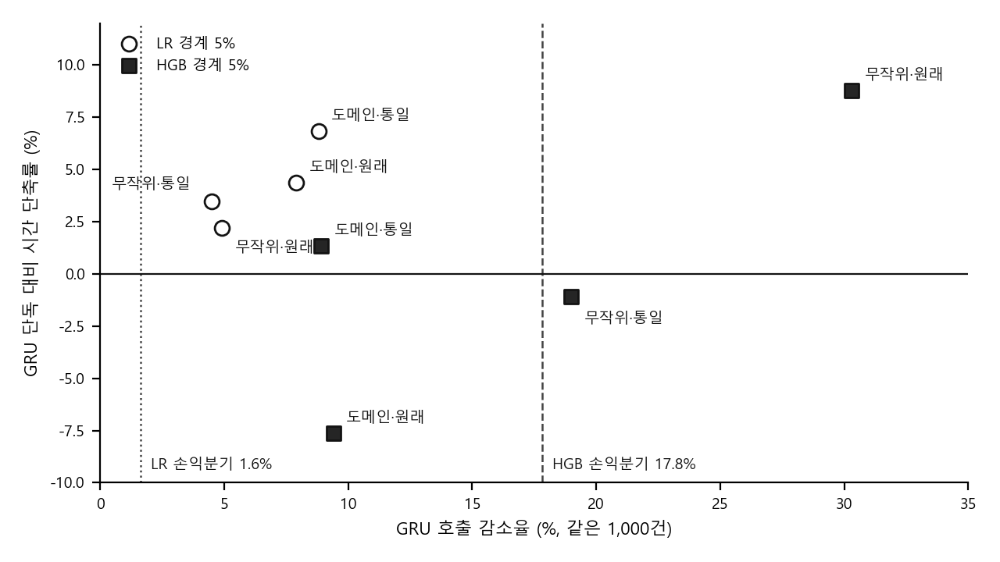

# 보고서 추가안: 캐스케이드 손익분기와 뒷받침 문헌

11월 24일 보고서에 넣을 표 1개, 그림 1개, 문장, 참고문헌이다. 새로 학습하거나 측정한 것은 없다. 손익분기는 조건별 `timing.json`에 이미 기록된 단계별 시간으로 계산했다.

```powershell
python experiments/upstream_partition/breakeven.py
```

결과는 [breakeven.json](../../evidence/upstream-partition-20261124/summary/breakeven.json)과 [breakeven.png](breakeven.png)에 있다.

## 1. 손익분기 (6장 표 19 뒤에 넣는 안)

### 계산 방법

시간 측정은 한 배치를 수치 특징 계산, 1단계 분기, GRU 추론 세 구간으로 나눠 기록했다. 세 구간의 합은 전체 시간과 같다(140회 모두 0.01 ms 이내).

- GRU 1건당 시간: 네 조건 × 7개 구성 × 5회, 140회 측정에서 `GRU 시간 = 조건별 상수 + 건당 시간 × GRU 호출 수`를 최소제곱으로 맞췄다. 건당 0.0275 ms다. 조건 안에서 회차를 다시 뽑은 2,000회 부트스트랩의 95% 구간은 0.0256~0.0296 ms다.
- 1단계 비용: 조건과 모델별 분기 구간 시간의 중앙값.
- 손익분기 호출 감소율 = 1단계 비용 ÷ GRU 건당 시간 ÷ 1,000건.

수치 특징 계산은 약 10~11 ms로 모든 구성에 똑같이 든다. 그래서 GRU 호출을 30% 줄여도 전체 시간은 그만큼 줄지 않는다.

### 표 20. 1단계 비용과 손익분기 호출 감소율 (같은 1,000건, 경계 5% 구성)

| 분할 · 표기 | 1단계 | 1단계 비용 (ms) | 손익분기 호출 감소율 | 실제 호출 감소율 | 실제 시간 단축률 |
|---|---|---:|---:|---:|---:|
| 무작위 · 원래 | LR | 0.41 | 1.5% | 4.9% | 2.19% |
| 무작위 · 원래 | HGB | 4.86 | 17.7% | 30.3% | 8.79% |
| 무작위 · 통일 | LR | 0.40 | 1.4% | 4.5% | 3.46% |
| 무작위 · 통일 | HGB | 5.10 | 18.5% | 19.0% | -1.10% |
| 도메인 · 원래 | LR | 0.50 | 1.8% | 7.9% | 4.38% |
| 도메인 · 원래 | HGB | 4.60 | 16.7% | 9.4% | -7.64% |
| 도메인 · 통일 | LR | 0.49 | 1.8% | 8.8% | 6.85% |
| 도메인 · 통일 | HGB | 5.04 | 18.3% | 8.9% | 1.36% |

GRU 건당 시간의 95% 구간을 적용하면 HGB의 손익분기는 조건에 따라 15.5~19.9%, LR은 1.3~1.9%다.

### 그림 2. GRU 호출 감소율과 시간 단축률



세로 점선은 네 조건 평균 손익분기다(LR 1.6%, HGB 17.8%).

### 본문에 넣을 문장

> HGB의 1단계 계산은 1,000건에 4.6~5.1 ms로 LR(0.4~0.5 ms)의 약 10배다. GRU 1건당 추론 시간 0.0275 ms로 나누면 HGB는 GRU 호출을 약 17~19%, LR은 약 1.5~2% 줄여야 1단계 비용을 회수한다.
>
> 실제 결과는 이 기준과 대체로 맞는다. HGB가 호출을 30.3% 줄인 무작위·원래 표기에서만 시간이 뚜렷이 줄었고(8.79%), 19.0%를 줄인 무작위·통일 표기에서는 손익분기 근처여서 시간이 거의 같았다(-1.10%). 9.4%를 줄인 도메인·원래 표기에서는 느려졌다(-7.64%). LR은 네 조건 모두 손익분기를 넘어 2.19~6.85% 빨랐다.
>
> 도메인·통일 표기의 HGB는 호출을 8.9%만 줄였는데 1.36% 빨랐다. 이 구성의 5회 범위(44.93~47.88 ms)는 GRU 단독의 범위(44.08~46.43 ms)와 겹치므로 측정 변동으로 본다.
>
> 손익분기는 GRU 건당 시간에 반비례한다. 2단계 모델의 건당 추론 시간이 이 GRU의 5배라면 HGB의 손익분기는 약 3.6%로 내려간다. 이 값은 위 식에서 계산한 것이고 측정하지 않았다.

### 한계

- 한 CPU, 스레드 1개, 배치 1,000건에서의 값이다. 배치 크기나 장비가 달라지면 GRU 건당 시간과 1단계 비용이 모두 달라진다.
- GRU 시간이 호출 수에 비례한다고 가정했다. 도메인 분할은 구성들의 호출 수가 902~1,000건에 몰려 있어 조건별로 따로 맞추면 기울기가 불안정하다. 그래서 네 조건을 합쳐 기울기 하나를 추정했다.
- 손익분기는 시간만 다룬다. 호출을 더 줄이려고 임계값을 올리면 추가 미탐이 늘어난다.

## 2. 뒷받침 문헌 (7장 참고문헌 [3]~[7])

`docs/related-work.md`에서 2026-11-17에 공개 PDF 원문으로 제목, 저자, 게재처와 해당 내용을 확인한 5편이다. 아래 문장은 그 문서에 적은 확인 내용 안에서만 썼다.

### 본문에 넣을 문장과 위치

| 위치 | 문장 |
|---|---|
| 1장 첫 문단 | 블랙리스트는 새로 생긴 악성 주소를 담지 못하므로 학습 기반 탐지가 연구되어 왔다 [3]. 페이지를 받지 않고 주소 문자열만으로 판정하면 사용자에게 안전하고 분류 비용도 낮다 [4]. |
| 2장 첫 문단 | 원저자 모델은 URL의 문자 단위 표현을 신경망으로 학습하는 계열에 속한다 [5]. |
| 3장 첫 문단 | 정답 라벨이 부정확하면 성능 평가 전체가 흔들린다 [6]. 널리 쓰이는 10개 데이터셋의 시험 집합에서도 평균 3.3% 이상의 라벨 오류가 보고됐다 [7]. |
| 5.6 (표 13 아래) | 보안 문제와 무관한 인공물이 클래스를 가르는 단서가 되면 모델은 과제 대신 그 단서를 학습한다 [6]. 접두 표기와 라벨의 연관은 이 경우에 해당할 수 있다. |
| 6장 마지막 문단 | 시험 집합을 최종 평가 전에 사용하면 설정에 시험 정보가 들어간다 [6]. 배치 학습 모델은 수집 시점이 달라지면 성능이 변할 수 있다 [3]. |

### 참고문헌

- [3] Doyen Sahoo, Chenghao Liu, and Steven C.H. Hoi. Malicious URL Detection using Machine Learning: A Survey. arXiv:1701.07179, 2017. https://arxiv.org/abs/1701.07179
- [4] Justin Ma, Lawrence K. Saul, Stefan Savage, and Geoffrey M. Voelker. Beyond Blacklists: Learning to Detect Malicious Web Sites from Suspicious URLs. KDD, 2009. https://cseweb.ucsd.edu/~savage/papers/KDD09.pdf
- [5] Hung Le, Quang Pham, Doyen Sahoo, and Steven C.H. Hoi. URLNet: Learning a URL Representation with Deep Learning for Malicious URL Detection. arXiv:1802.03162, 2018. https://arxiv.org/abs/1802.03162
- [6] Daniel Arp, Erwin Quiring, Feargus Pendlebury, Alexander Warnecke, Fabio Pierazzi, Christian Wressnegger, Lorenzo Cavallaro, and Konrad Rieck. Dos and Don'ts of Machine Learning in Computer Security. USENIX Security Symposium, 2022. https://www.usenix.org/system/files/sec22-arp.pdf
- [7] Curtis G. Northcutt, Anish Athalye, and Jonas Mueller. Pervasive Label Errors in Test Sets Destabilize Machine Learning Benchmarks. NeurIPS Datasets and Benchmarks Track, 2021. https://arxiv.org/abs/2103.14749
